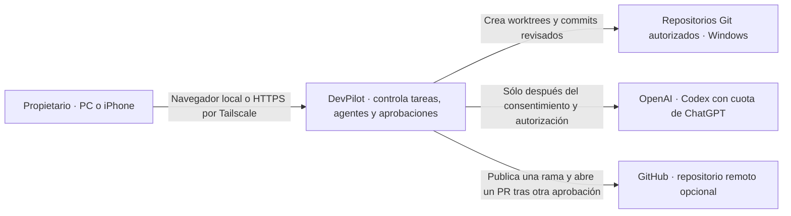
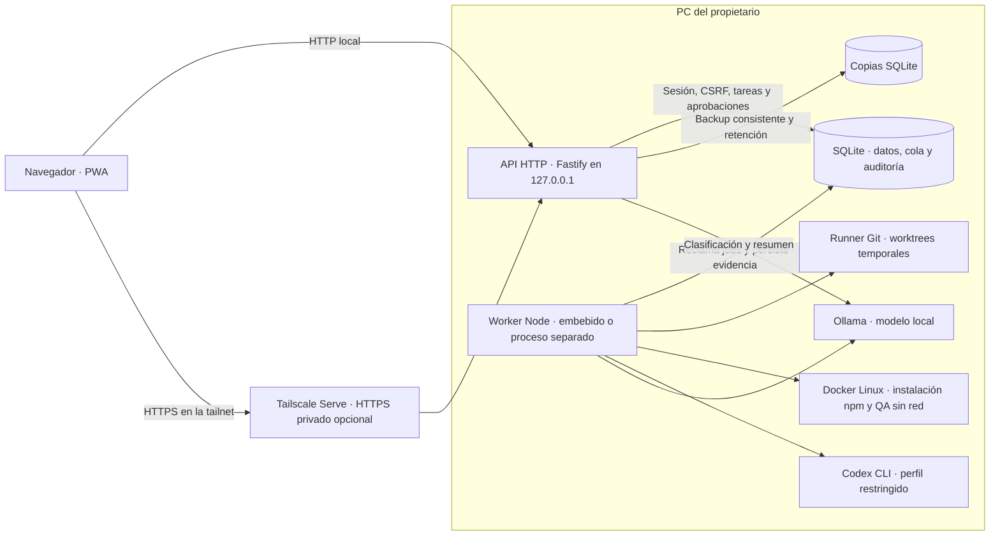

# Arquitectura de DevPilot

## Nivel 1 · Contexto del sistema

## Nivel 2 · Contenedores

Los checks Docker trabajan sobre un volumen descartable. El worker registra el árbol de Git que se presenta para revisión. La aprobación genera un commit desde ese árbol y actualiza únicamente la rama de la ejecución. Una interrupción durante el trabajo se registra como `UNKNOWN` al reiniciar.
